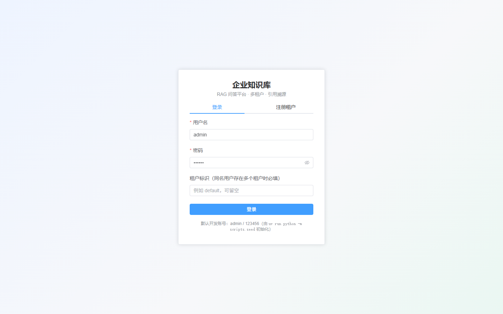
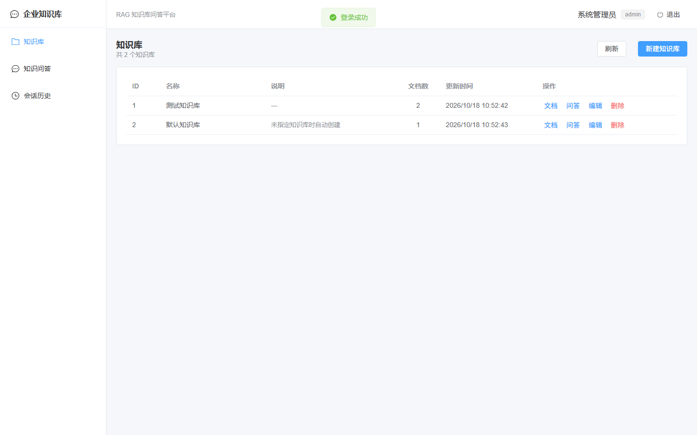
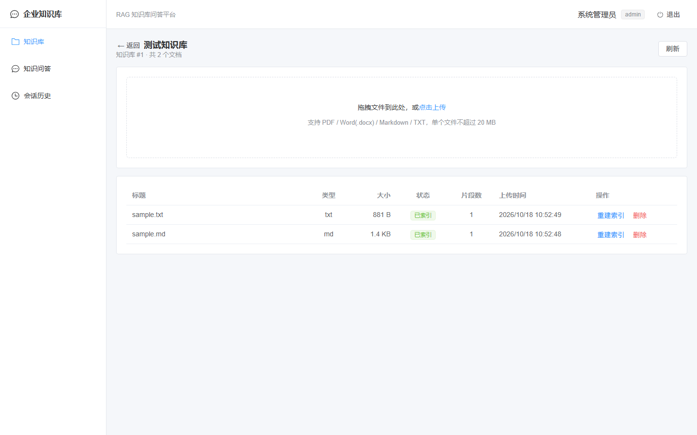
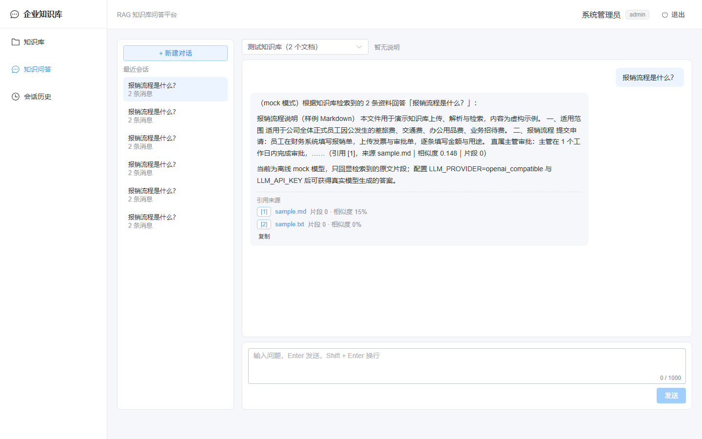
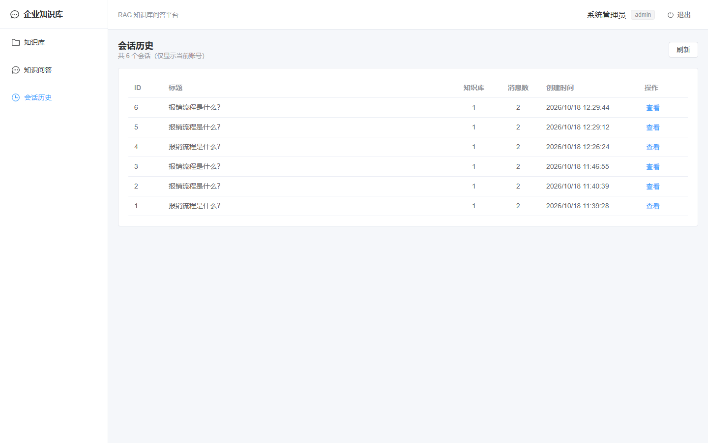
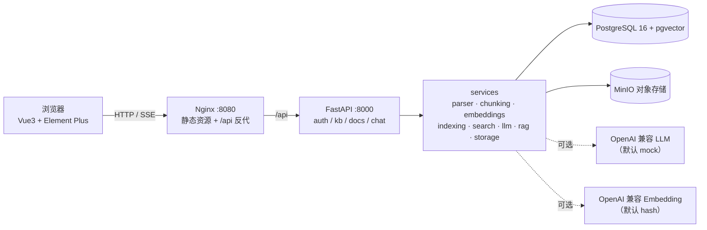

# ai-rag-knowledge-py

企业知识库 RAG 问答平台：**多租户 + RBAC + JWT**、知识库与文档管理、PDF/Word/Markdown/TXT
解析切片、**pgvector** 向量检索、**SSE 流式问答 + 引用溯源**、Vue3 管理端与问答页，
`docker compose up -d --build` 一键启动。

> Python 3.12（uv 管理）· FastAPI · PostgreSQL 16 + pgvector · Redis 7 · MinIO ·
> Vue3 + Vite + TypeScript + Element Plus · Docker Compose · GitHub Actions

## 功能特性

- **多租户隔离**：JWT 内嵌 `tid`，所有查询强制 `tenant_id` 过滤，跨租户访问返回 404
- **RBAC**：权限目录 + 租户内角色（admin / member），`require_permission` 依赖逐接口校验
- **知识库管理**：增删改查、文档数统计、软删除
- **文档处理**：PDF / Word(.docx) / Markdown / TXT 上传 → 解析 → 切片 → 向量化 → 入库（上传即索引）
- **向量检索**：pgvector 余弦相似度 + HNSW 索引，按知识库过滤，返回片段与相似度
- **RAG 问答**：Prompt 组装（资料编号 + 引用要求）、SSE 流式输出、答案带引用来源、会话历史
- **降级可用**：LLM 默认 `mock`、Embedding 默认 `hash`，无任何 Key 也能跑通全流程
- **前端**：登录/注册、知识库、文档上传、流式问答（Markdown + 引用）、会话历史

## 界面预览

| 登录 | 知识库 |
| --- | --- |
|  |  |

| 文档管理 | 流式问答 |
| --- | --- |
|  |  |

| 会话历史 |
| --- |
|  |

> 截图为本项目实际运行界面（headless Edge 抓取，mock LLM + hash Embedding 模式）。

## 架构



详细设计（时序图、模块说明、选型理由）见 [docs/architecture.md](docs/architecture.md)，
数据库 ER 与索引选型见 [docs/database.md](docs/database.md)。

## 技术栈

| 层 | 选型 |
| --- | --- |
| 后端 | Python 3.12（uv）、FastAPI、Uvicorn、Pydantic v2、SQLAlchemy 2、Alembic |
| 数据库 | PostgreSQL 16 + pgvector（HNSW 索引，`vector(1536)`） |
| 缓存 / 存储 | Redis 7、MinIO |
| 鉴权 | JWT（PyJWT）、passlib[bcrypt] |
| 文档解析 | pypdf、python-docx、markdown |
| LLM / Embedding | OpenAI 兼容接口，支持 `mock` / `hash` 降级 |
| SSE | sse-starlette |
| 前端 | Vue 3、Vite 6、TypeScript、Element Plus、Axios、Pinia、vue-router |
| 测试 / 质量 | pytest、pytest-asyncio、httpx、ruff |
| 部署 / CI | Docker、Docker Compose、Nginx、GitHub Actions |

## 快速开始（Docker 一键启动）

```powershell
Copy-Item .env.example .env          # 1) 环境变量（.env 不提交）
docker compose up -d --build          # 2) 构建并启动全部服务
docker compose ps                     # 3) 等 backend / frontend 变 healthy
```

或使用脚本：`powershell -ExecutionPolicy Bypass -File scripts\bootstrap.ps1`

| 入口 | 地址 |
| --- | --- |
| 前端 | <http://localhost:8080>（默认账号 `admin / 123456`） |
| 后端 API 文档 | <http://localhost:8000/docs> |
| 健康检查 | <http://localhost:8000/health>、<http://localhost:8080/health> |
| MinIO 控制台 | <http://localhost:9001> |

服务端口：`8080`（前端）、`8000`（后端）、**`5433`**（PostgreSQL，映射到 5433 以避让
可能已被占用的 5432）、`6379`（Redis）、`9000/9001`（MinIO）。

### 本地开发模式

```powershell
docker compose up -d postgres redis minio   # 只起基础设施
uv sync
uv run alembic upgrade head
uv run python -m scripts.seed                # 默认租户 + admin/123456
uv run uvicorn app.main:app --reload         # 必须带 --reload（Windows 事件循环）

cd frontend
npm install
npm run dev                                  # http://localhost:5173，已代理 /api
```

> **Windows 提示**：`psycopg` 异步驱动不支持默认的 ProactorEventLoop，本地后端必须用
> `--reload`（或 `--workers 2`）；Linux 容器不受影响。`npm run build` 若报 esbuild
> `Access is denied`，`vite.config.ts` 已自动把临时目录指到 `frontend/.tmp`。

## 目录结构

```text
app/            FastAPI 应用
  core/         配置、数据库、JWT/密码、统一错误、事件循环兼容
  api/          路由（auth / kb / docs / chat）与依赖（当前用户、权限校验）
  models/       ORM（tenants / users / roles / permissions / kb / documents / chunks / conversations / messages）
  schemas/      Pydantic 请求响应（含统一分页与错误结构）
  services/     解析、切片、Embedding、索引、检索、LLM、RAG、存储、业务逻辑
alembic/        迁移（0001 baseline → 0005 chat）
tests/          pytest（独立 rag_test 库，跑真实迁移）
frontend/       Vue3 + Element Plus 前端
deploy/         Dockerfile（多阶段）、nginx.conf、entrypoint.sh
docs/           环境、架构、数据库、API、部署、开发规范、设计方案
scripts/        start-docker / verify / bootstrap（PowerShell）与 seed（Python）
```

## 环境变量

完整模板见 [.env.example](.env.example)，关键项：

| 变量 | 说明 | 默认 |
| --- | --- | --- |
| `SECRET_KEY` | JWT 签名密钥，**生产必须替换（≥32 字节）** | `change-me` |
| `DATABASE_URL` | 本地开发连接串（宿主 5433）；compose 内覆盖为 `postgres:5432` | — |
| `MINIO_*` | MinIO 地址与凭据 | `localhost:9000` / `minioadmin` |
| `STORAGE_PROVIDER` | `minio` 或 `local`（离线降级） | `minio` |
| `MAX_UPLOAD_MB` | 单文件上限 | `20` |
| `SEED_DEFAULT_DATA` | 容器启动时创建默认租户/管理员 | `true`（生产改 `false`） |
| `LLM_PROVIDER` | `mock` / `openai_compatible` | `mock` |
| `EMBEDDING_PROVIDER` | `hash` / `openai_compatible` | `hash` |
| `CHUNK_SIZE` / `CHUNK_OVERLAP` / `TOP_K` | 切片与检索参数 | `800` / `120` / `5` |

## API 概览

统一前缀 `/api`，鉴权 `Authorization: Bearer <token>`，错误统一
`{"code": int, "message": str, "detail": {}}`，分页统一 `{items,total,page,page_size}`。
完整说明见 [docs/api.md](docs/api.md)。

| 方法 | 路径 | 说明 | 权限 |
| --- | --- | --- | --- |
| GET | `/health` | 健康检查 | 无 |
| POST | `/api/auth/register` | 注册租户 + 管理员 | 无 |
| POST | `/api/auth/login` | 登录获取 JWT | 无 |
| GET | `/api/auth/me` | 当前用户 + 角色 + 权限 | 登录 |
| GET/POST | `/api/auth/users` | 租户内用户列表 / 创建 | `users:read` / `users:write` |
| POST/GET | `/api/kb` | 创建 / 列表 | `kb:write` / `kb:read` |
| GET/PATCH/DELETE | `/api/kb/{id}` | 详情 / 更新 / 删除 | `kb:read` / `kb:write` |
| GET | `/api/kb/search` | 向量检索 | `kb:read` |
| POST | `/api/docs/upload` | 上传并自动索引 | `docs:write` |
| GET | `/api/docs` | 文档列表 | `docs:read` |
| GET/DELETE | `/api/docs/{id}` | 文档详情 / 删除 | `docs:read` / `docs:write` |
| POST | `/api/docs/{id}/reindex` | 重建切片与向量 | `docs:write` |
| POST | `/api/chat/ask` | RAG 问答（SSE 流式 + 引用） | `chat:ask` |
| GET | `/api/chat/history` | 会话历史列表 | `chat:ask` |
| GET | `/api/chat/history/{id}` | 会话详情（含引用） | `chat:ask` |

### 示例

```powershell
# 登录
$login = curl.exe -s -X POST http://localhost:8080/api/auth/login `
  -H "Content-Type: application/json" -d '{"username":"admin","password":"123456"}'
$token = ($login | ConvertFrom-Json).access_token

# 上传文档（省略 kb_id 时写入默认知识库）
curl.exe -s -F "file=@docs/sample.md" -F "kb_id=1" `
  -H "Authorization: Bearer $token" http://localhost:8080/api/docs/upload

# 向量检索（中文查询必须 URL 编码）
curl.exe -s -G http://localhost:8080/api/kb/search `
  --data-urlencode "kb_id=1" --data-urlencode "q=报销流程" `
  -H "Authorization: Bearer $token"

# SSE 流式问答（-N 关闭缓冲）
curl.exe -N -X POST http://localhost:8080/api/chat/ask `
  -H "Content-Type: application/json" -H "Authorization: Bearer $token" `
  -d '{"kb_id":1,"question":"报销流程是什么？"}'
```

SSE 事件：`message`（增量文本）、`done`（会话 id、消息 id、引用列表）、`error`。

## RAG 检索说明

```text
上传 → 解析 → 切片 → 向量化 → 写入 chunks(embedding)
                                     │
提问 → 向量化 query → pgvector 余弦 top_k → Prompt(【资料】+【问题】) → LLM → SSE → 引用
```

- **切片**：字符窗口 `CHUNK_SIZE`（800），相邻重叠 `CHUNK_OVERLAP`（120），
  优先在段落 / 换行 / 句末标点断开
- **向量**：`vector(1536)` + HNSW（`vector_cosine_ops`）；无需训练数据、空表可建、
  插入即生效（对比 IVFFlat 的理由见 [docs/database.md](docs/database.md)）
- **检索**：`score = 1 - 余弦距离`，按知识库 + 租户过滤，`top_k` 默认 5
- **Prompt**：system 要求只依据资料回答、结论标 `[n]`、资料不足要说明；
  user 为「【资料】编号片段（含相似度）→【问题】」
- **引用**：`done` 事件返回 `index / document_title / filename / chunk_id / chunk_index / score / snippet`，
  同时以 JSONB 落库，历史会话可追溯

## mock / hash 降级模式

项目默认**完全离线可运行**，不依赖任何付费或外部模型 API：

- **LLM `mock`**：不发网络请求，回显检索到的资料片段并带 `[n]` 标记，用于打通
  上传 → 解析 → 检索 → 流式问答全链路
- **Embedding `hash`**：本地确定性哈希向量（md5 定位维度 + 符号，L2 归一化），
  零依赖零成本，**只捕捉词汇重叠**，语义泛化能力弱
- **存储 `local`**：将对象写入本地目录，便于无 MinIO 环境测试
- 任何外部服务不可用时系统仍能启动并跑通主流程；降级只通过 `.env` 开关完成，业务代码无硬编码

## 切换真实模型

**LLM → OpenRouter 免费 DeepSeek**

```dotenv
LLM_PROVIDER=openai_compatible
LLM_BASE_URL=https://openrouter.ai/api/v1
LLM_API_KEY=sk-or-v1-你的Key
LLM_MODEL=deepseek/deepseek-v4-flash:free
```

> 免费模型限流约 20 次/分钟、50 次/天（账户未充值 $10 前）；首个 token 前失败会自动降级 `mock`。

**Embedding → OpenAI 兼容服务**

```dotenv
EMBEDDING_PROVIDER=openai_compatible
EMBEDDING_BASE_URL=https://api.openai.com/v1
EMBEDDING_API_KEY=sk-你的Key
EMBEDDING_MODEL=text-embedding-3-small
EMBEDDING_DIM=1536
```

切换 Embedding 后必须重建向量：对已有文档调用 `POST /api/docs/{id}/reindex`
（`hash` 与真实模型向量空间不兼容）。`EMBEDDING_DIM` 必须与 `vector(1536)` 一致。

## 安全说明

- `.env` 永不提交，`.env.example` 只放占位符；密钥只从环境变量读取
- 密码 bcrypt 哈希（拒绝 >72 字节），JWT 密钥 ≥32 字节且不进代码
- 上传文件校验扩展名白名单与大小上限；对象键做路径穿越清理
- 跨租户查询强制 `tenant_id`，会话按 `user_id` 二次隔离
- 日志不输出密码 / Token / API Key
- 生产清单：替换 `SECRET_KEY` 与数据库 / MinIO 口令、`SEED_DEFAULT_DATA=false`、加 HTTPS

## 开发与测试

```powershell
uv run pytest                # 76 项测试（独立 rag_test 库，跑真实迁移）
uv run ruff check .          # 代码检查
uv run alembic upgrade head  # 数据库迁移
cd frontend; npm run type-check; npm run build
powershell -ExecutionPolicy Bypass -File scripts\verify.ps1 -Full   # 环境 + 接口验收
```

CI（[.github/workflows/ci.yml](.github/workflows/ci.yml)）：后端 ruff + pytest（带 pgvector
service）、前端 `npm ci` + 类型检查 + 构建、Compose 配置与 Dockerfile 校验。

## 文档

- [docs/architecture.md](docs/architecture.md)：架构图、数据流、模块说明、选型理由
- [docs/design.md](docs/design.md)：设计目标、关键决策与取舍、里程碑
- [docs/database.md](docs/database.md)：ER 图、表说明、索引选型
- [docs/api.md](docs/api.md)：接口列表与示例
- [docs/deploy.md](docs/deploy.md)：部署、环境变量、常见问题
- [docs/env.md](docs/env.md)：运行环境要求、端口规划、已知问题
- [docs/development.md](docs/development.md)：目录规范、编码风格、测试与提交约定
- [CHANGELOG.md](CHANGELOG.md)：版本变更记录

## License

[MIT](LICENSE)
