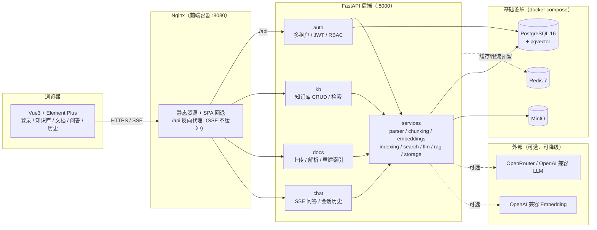
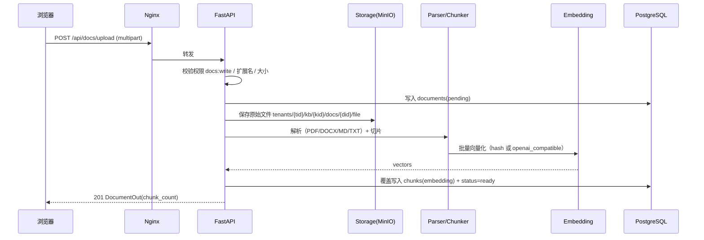
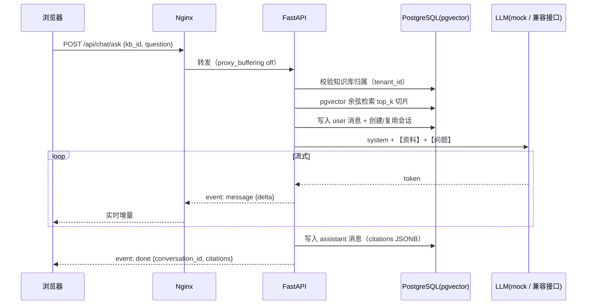

# 系统架构

## 1. 总体架构

要点：

- **单容器后端**：`app/` 一个 FastAPI 应用，按 `api/`（路由）、`services/`（业务）、`models/`（ORM）、
  `schemas/`（Pydantic）分层。
- **前端独立容器**：Nginx 托管 `dist/`，并把 `/api` 反代到后端；SSE 必须 `proxy_buffering off`。
- **降级优先**：LLM 默认 `mock`、Embedding 默认 `hash`，无任何 Key 也能跑通全链路；
  Redis 目前仅预留（后续做缓存/限流）。
- **多租户**：JWT 里带 `tid`，所有查询强制 `tenant_id` 过滤。

## 2. 数据流

### 2.1 文档上传与索引

失败语义：解析/向量化失败只把 `documents.status` 置为 `failed` 并写 `error_message`，
上传本身仍返回 201，可用 `POST /api/docs/{id}/reindex` 重建。

### 2.2 RAG 流式问答

降级：LLM 在首个 token 前不可用（无 Key / 429 / 网络错误）时自动切换到 `mock`，流不中断。

## 3. 模块说明

| 目录 | 职责 |
| --- | --- |
| `app/core/` | 配置（`config.py`）、数据库引擎（`db.py`）、安全（`security.py`：bcrypt + JWT）、统一错误（`errors.py`）、Windows 事件循环兼容（`asyncio_compat.py`） |
| `app/api/` | 路由：`auth`、`kb`、`docs`、`chat`；`deps.py` 提供会话、当前用户、`require_permission` |
| `app/models/` | SQLAlchemy 2.0 ORM：tenants/users/roles/permissions/knowledge_bases/documents/chunks/conversations/messages |
| `app/schemas/` | Pydantic v2 请求/响应模型，含统一分页 `Page[T]` 与错误结构 |
| `app/services/` | `auth`、`rbac`、`kb`、`document`、`storage`（minio/local）、`parser`、`chunking`、`embeddings`、`indexing`、`search`、`llm`、`rag`、`chat` |
| `alembic/` | 迁移：0001 baseline → 0002 auth → 0003 kb/docs → 0004 pgvector → 0005 chat |
| `frontend/src/` | `api/`（Axios + SSE）、`stores/`（Pinia）、`router/`（守卫）、`views/`、`components/` |
| `tests/` | pytest（独立 `rag_test` 库，跑真实迁移） |

## 4. 技术选型理由

| 选择 | 理由 |
| --- | --- |
| PostgreSQL + pgvector | 关系数据与向量放在同一个库，事务一致、无需额外向量数据库 |
| HNSW 索引 | 空表可建、无需训练，插入即生效；召回/延迟优于 IVFFlat（详见 `docs/database.md`） |
| hash Embedding 默认 | 零依赖零成本，保证无 Key 也能演示；语义质量需切真实模型 |
| mock LLM 默认 | 免费模型限流严重（20 次/分、50 次/天），mock 保证离线可测 |
| SSE 而非 WebSocket | 单向流式、HTTP 友好、Nginx 反代简单 |
| uv 管理 Python | 锁定 3.12，锁定 `uv.lock`，构建可复现 |
