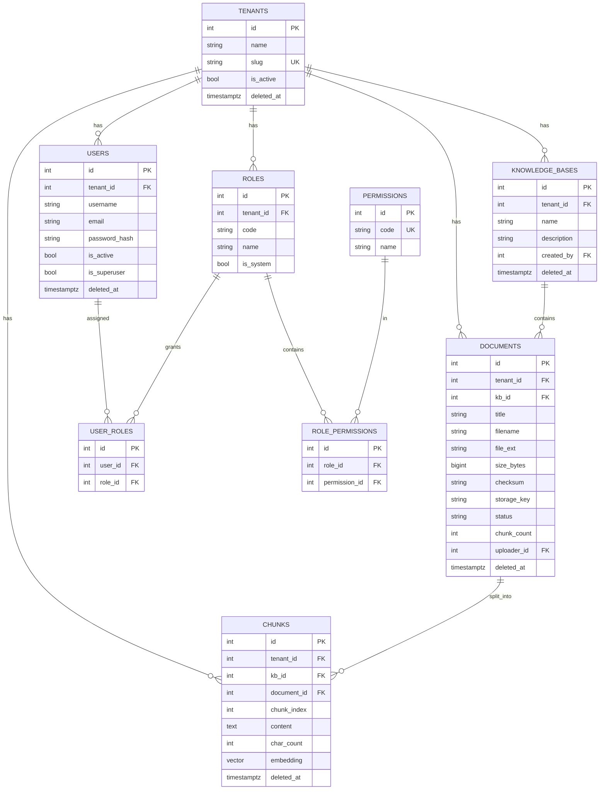

# 数据库设计

- 数据库：PostgreSQL 16（容器 `pgvector/pgvector:pg16`，宿主端口 **5433**）
- 扩展：`vector 0.8.7`（pgvector）
- 迁移：Alembic，禁止手改数据库

## 1. ER 图



## 2. 表说明

| 表 | 说明 | 关键约束 |
| --- | --- | --- |
| `tenants` | 租户（组织） | `slug` 唯一 |
| `users` | 用户 | `unique(tenant_id, username)`、`unique(tenant_id, email)` |
| `roles` | 租户内角色 | `unique(tenant_id, code)` |
| `permissions` | 全局权限目录 | `code` 唯一 |
| `user_roles` | 用户-角色 | `unique(user_id, role_id)` |
| `role_permissions` | 角色-权限 | `unique(role_id, permission_id)` |
| `knowledge_bases` | 知识库 | `unique(tenant_id, name)` |
| `documents` | 文档元数据 | `status ∈ {pending, processing, ready, failed}` |
| `chunks` | 文档切片 + 向量 | `unique(document_id, chunk_index)` |

约定：

- 所有表都有 `id`、`created_at`、`updated_at`（Python 侧默认值 + 数据库 `now()` 兜底）
- 多租户表都有 `tenant_id`，查询强制过滤
- 软删除统一用 `deleted_at`（可空）；检索与列表都带 `deleted_at IS NULL`
- 外键全部建索引；级联删除通过 `ON DELETE CASCADE`

## 3. 索引与选型理由

| 索引 | 类型 | 用途 |
| --- | --- | --- |
| `ix_users_tenant_id` / `ix_roles_tenant_id` / `ix_knowledge_bases_tenant_id` / `ix_documents_tenant_id` / `ix_chunks_tenant_id` | btree | 租户隔离过滤 |
| `ix_users_username`、`ix_users_email` | btree | 登录与冲突检查 |
| `ix_documents_kb_id`、`ix_chunks_document_id`、`ix_chunks_kb_id` | btree | 按知识库/文档查询切片 |
| `ix_documents_status` | btree | 按处理状态筛选 |
| `ix_documents_checksum` | btree | 去重/审计 |
| `ix_*_deleted_at` | btree | 软删除过滤 |
| **`ix_chunks_embedding_hnsw`** | **HNSW（`vector_cosine_ops`）** | **向量相似度检索** |

### 为什么选 HNSW 而不是 IVFFlat

1. **无需训练数据**：IVFFlat 需要先有数据才能 `CREATE INDEX` 并训练聚类中心，空表建索引会得到无效索引；
   HNSW 可在空表上建索引，插入即生效，适合从零开始、持续增量写入的知识库。
2. **召回率与延迟更优**：同等召回下 HNSW 的查询延迟通常优于 IVFFlat，且不受 `lists`/`probes` 参数调优影响。
3. **代价**：HNSW 需要更多内存与更长的构建时间；本项目文档规模中等（单机、无 GPU），可接受。
   若未来数据量极大或内存紧张，可改为 IVFFlat 并在数据量足够时重建索引。

向量维度固定 **1536**（`vector(1536)`），必须与 `EMBEDDING_DIM` 一致；
更换 embedding 模型导致维度变化时，需要新增迁移重建该列并重建索引。

## 4. 迁移历史

| Revision | 内容 |
| --- | --- |
| `0001_baseline` | 空基线，建立 `alembic_version` |
| `0002_auth` | `tenants`、`permissions`、`roles`、`users`、`user_roles`、`role_permissions` |
| `0003_kb_docs` | `knowledge_bases`、`documents`、`chunks` |
| `0004_pgvector` | `CREATE EXTENSION vector`、`chunks.embedding vector(1536)`、HNSW 索引 |
| `0005_chat` | `conversations`、`messages`（含 `citations JSONB`） |

执行：

```powershell
uv run alembic upgrade head
uv run alembic current
uv run alembic downgrade -1     # 回退一步
```

## 5. 测试库

`tests/conftest.py` 自动创建 `rag_test` 库并执行全部迁移，与开发库 `rag` 完全隔离；
每个用例前 `TRUNCATE` 业务表并清空本地测试存储目录。
